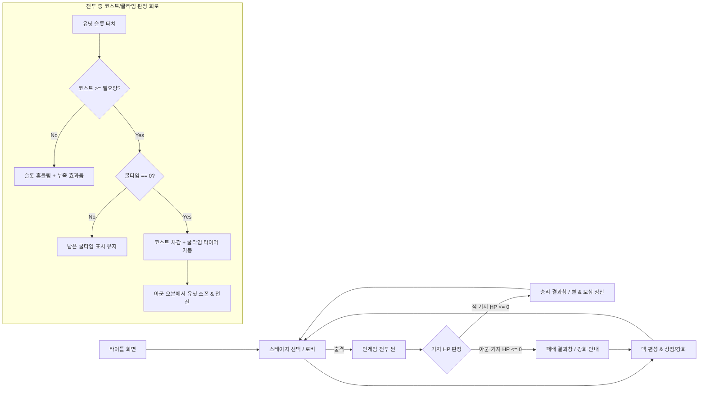

# [기획초안] 세계관 컨셉 및 아군/적군 캐릭터 기믹 제안 (호걸)

## 0. 문서 개요 및 프로젝트 전제 조건

- 프로젝트 가제: 빵집 사수대 - 오븐 왕국 방어전 (가칭)
- 장르: 2D 횡스크롤 단일 라인 디펜스 (Single-Line Push Defense)
- 개발 환경: Unity 6.6 (6000.6.9f1) 2D URP / Android 8.0+ (SDK 26 이상) / 가로 고정(Landscape 16:9, 1920x1080 기준)
- 데이터 구조: 싱글플레이 중심, 로컬 저장(Local JSON / PlayerPrefs), 단기(2~4주) 완성 목표에 맞춘 미니멀 확장형 설계

---

## 1. 세계관 및 스토리 (Q1 대응)

### 1-1. 배경 시대 및 분위기 (Q1-1)
- 시공간 배경: 달콤한 버터와 밀가루 향기가 가득한 판타지 제과 마을 '크럼블 타운'의 황금 오븐 제국.
- 전체 분위기: 아기자기하고 코믹한 캐주얼 2D 카툰 감성. 진지한 전쟁 서사 대신, 오븐에서 갓 구워진 빵 기사들이 치즈와 빵을 노리는 욕심쟁이 쥐 해적단을 유쾌하게 밀어내는 명랑 활극 톤.

### 1-2. 아군 vs 적군 대립 구도 (Q1-2)
- 아군 진영 (식빵 기사단): 제빵 장인 할아버지의 마법 효모로 생명을 얻은 갓 구운 빵과 동물 조수들. 아군 본진은 따뜻한 벽돌 오븐 제과점.
- 적군 진영 (도둑 쥐 해적단): 뒷골목 하수구에서 몰려와 제과점의 '황금 레시피 치즈'와 반죽을 훔치려는 도둑 쥐 무리. 적군 본진은 낡은 치즈 창고 성채.

### 1-3. 기승전결 및 엔딩 구조 (Q1-3)
- 기 (Stage 1~3, 아늑한 시골 빵집 앞마당): 보름달이 뜬 어느 날, 굶주린 도둑 쥐 해적단이 크럼블 타운 외곽 빵집을 습격한다. 갓 구운 식빵 방패병과 바게트 창병이 긴급 출동해 1차 침공을 막아낸다.
- 승 (Stage 4~7, 노을 지는 밀가루 풍차 언덕): 물러난 쥐들이 치즈 방패와 새총, 폭탄까지 들고 밀가루 수송로를 가로막는다. 마카롱 궁수와 생크림 포격수가 합류하며 공방이 치열해진다.
- 전 (Stage 8~9, 달빛 아래 치즈 성채 입구): 쥐 해적단의 본진 성채가 모습을 드러내고, 폭발 돌격과 중장갑 공세가 몰아친다. 에스프레소 기사까지 참전하여 성문 돌파전을 벌인다.
- 결 및 엔딩 (Stage 10, 황금 오븐 최후의 결전): 거대한 '해적왕 대왕쥐'가 삼지창을 휘두르며 등장한다. 대왕쥐의 체력을 0으로 만들고 치즈 성채를 무너뜨리면 해적단이 항복하고, 제과점에 다시 평화가 찾아오며 특별 레시피 엔딩 일러스트와 함께 클리어 처리된다(이후 별 3개 도전 및 반복 파밍 가능).

---

## 2. 핵심 플레이 방식 및 차별화 요소 (Q2 대응)

### 2-1. 코어 게임플레이 루프 (Q2-1)
- 기본 구조: 단일 1레인 횡스크롤 라인. 왼쪽 끝 아군 오븐 기지와 오른쪽 끝 적 치즈 성채 사이에서 양 진영 유닛이 자동으로 전진·교전한다.
- 승패 조건:
  - 승리: 적군 기지 HP를 0으로 만들면 즉시 스테이지 클리어.
  - 패배: 아군 기지 HP가 0이 되면 스테이지 실패(소모한 재화 일부 유지 또는 재도전).
- 오븐(지갑) 생산 자원 시스템: 전투 중 '밀가루(Cost)' 자원이 초당 자동으로 차오른다. 플레이어는 [밀가루 지갑 업그레이드] 버튼을 눌러 최대 보유량과 초당 회복 속도를 키울지, 당장 유닛을 소환할지 실시간으로 판단한다.
- 보조 편의 조작: 화면 우측 상단 일시정지 버튼, 1x / 2x 배속 토글 지원.

### 2-2. 차별화 요소 (킬러 피처) 후보안 (Q2-2)
- 오븐 피버 타임 (Oven Fever): 유닛이 적을 타격하거나 처치할 때마다 상단 중앙의 [피버 게이지]가 상승한다. 게이지가 100%에 도달하면 10초간 피버 모드가 발동되어 아군 전체 이동·공격 속도가 1.3배 빨라지고, 밀가루 회복 속도가 1.5배로 증가하며 화면 가장자리에 따뜻한 황금빛 오븐 열기 연출이 적용된다.
- 단기 개발 구현 난이도 평가: 전역 버프 변수 2개(공속/이동 배율, 코스트 회복 배율)와 타이머 1개만 추가하면 되므로 1주차~2주차 내 프로토타입 검증이 매우 용이한 구조다.

---

## 3. 재화, 경제 및 상점 구조 (Q3 대응)

### 3-1. 재화 종류 정의 (Q3-1)
- 인전투 자원 - 밀가루 (Cost): 전투 시작 시 0부터 차오르며 유닛 소환과 지갑 업그레이드에 사용. 스테이지 종료 시 초기화.
- 기본 성장 재화 - 골드 크럼 (Gold Crumb): 스테이지 클리어 및 적 처치 보상으로 획득. 유닛 레벨업, 오븐 기지 강화, 소모품 아이템 구매에 사용.
- 희귀 재화 - 황금 별사탕 (Star Candy): 스테이지 최초 클리어, 3별(노데미지/단시간 클리어) 달성, 일일 퀘스트 보상으로 획득. 영구 유물 해금이나 고급 덱 슬롯 확장에 사용.

### 3-2. 과금 모델(BM) 방향 (Q3-2)
- 무과금(F2P) 클리어 기준 설계: 로컬 싱글플레이 MVP 기준, 별도 서버 결제 없이 인게임 재화만으로 엔딩(Stage 10)까지 완주 가능하도록 밸런싱한다.
- 선택형 확장 여지: 추후 출시 시 보상형 광고(패배 시 부활, 클리어 보상 2배) 정도만 연결할 수 있게 인터페이스 여백만 열어둔다.

### 3-3. 상점 및 성장 동선 (Q3-3)
- 스테이지 클리어 -> 골드 크럼/별사탕 획득 -> [빵 도감/편성 화면]에서 주력 유닛 강화(+10% 스탯/레벨) 또는 [비밀 창고 상점]에서 소모품·유물 구매 -> 다음 스테이지 도전의 단순 루프로 구성한다.

---

## 4. 아이템 및 가격 체계 (Q4 대응)

### 4-1. 액티브 소모품 아이템 (Q4-1, 전투당 각 1회 사용)
| 아이템명 | 효과 | 쿨타임 / 사용 제한 | 상점 가격 |
| --- | --- | --- | --- |
| 전체 폭격 (시나몬 폭탄) | 전장 내 모든 적 유닛에게 최대 HP 비례 고정 피해(150) + 1.5초 넉백 | 스테이지당 1회 | 120 골드 크럼 |
| 기지 수리 (긴급 발효 반죽) | 아군 오븐 기지 HP를 최대 체력의 30% 즉시 회복 + 3초 방어막 | 스테이지당 1회 | 100 골드 크럼 |
| 오븐 가속 (뜨거운 효모) | 즉시 밀가루 +200 회복 및 5초간 피버 게이지 +40% 충전 | 스테이지당 1회 | 150 골드 크럼 |

### 4-2. 영구 패시브 유물 (Q4-2, 도감/창고 해금)
| 유물명 | 영구 효과 | 해금 조건 / 가격 |
| --- | --- | --- |
| 황금 오븐 장갑 | 아군 모든 유닛 기본 공격력 +10% | 500 골드 크럼 (Stage 3 클리어 후 해금) |
| 특제 천연 효모 | 전투 중 밀가루 초당 자동 회복 속도 +15% | 황금 별사탕 15개 |
| 두꺼운 벽돌 껍질 | 아군 오븐 기지 최대 HP +25% | 600 골드 크럼 (Stage 5 클리어 후 해금) |

### 4-3. 재화 소모처 및 강화 비용 예시 (Q4-3)
- 유닛 레벨업 (Lv.1 -> Lv.10): 100 * 현재 레벨 (Lv.1->2는 100, Lv.5->6은 500 골드 크럼). 레벨당 체력/공격력 각 +12% 상승.
- 스테이지 당 평균 획득 기대치: Stage 1 첫 클리어 시 150 골드 크럼 + 별사탕 3개, 반복 클리어 시 약 80~120 골드 크럼.

---

## 5. 아군 유닛 기획 및 스탯 테이블 (Q5 대응 / 필수 첨부)

아군 유닛 5종 모두 레벨 1 기준 스탯이다. (사거리 단위: Unity World Unit, 이속: Unit/sec)

| 이름 | 역할 / 병과 | 외형 컨셉 | 코스트 | 쿨타임 | 체력(HP) | 공격력 | 사거리 | 이속 | 공속(초당) | 특수 능력 및 기믹 | 해금 시점 |
| --- | --- | --- | --- | --- | --- | --- | --- | --- | --- | --- | --- |
| 식빵 방패병 | 근거리 탱커 / 고기방패 | 버터 나이프와 토스트 방패를 든 사각 식빵 기사 | 50 | 2.5초 | 280 | 18 | 0.9 | 1.6 | 1.1 | 저렴하고 재사용 대기가 짧아 전선 유지 담당 | 기본 보유 |
| 바게트 창병 | 근거리 돌격 / 서브 딜러 | 요리사 모자를 쓴 흰 고양이가 긴 바게트 창 돌진 | 100 | 4.0초 | 210 | 42 | 1.4 | 2.4 | 1.0 | 적과 조우 시 첫 타격 데미지 1.5배 및 소폭 밀쳐내기(넉백) | 기본 보유 |
| 마카롱 궁수 | 원거리 단일 딜러 | 분홍 토끼 궁수가 알록달록한 마카롱 화살 발사 | 150 | 5.0초 | 130 | 55 | 4.5 | 1.8 | 0.9 | 긴 사거리로 후방에서 적 탱커/원거리 저격 | Stage 2 클리어 |
| 생크림 포격수 | 원거리 광역 메즈/서포터 | 슈크림 빵 제빵사가 생크림 짤주머니로 크림탄 투척 | 220 | 7.5초 | 170 | 48 | 3.8 | 1.4 | 0.65 | 반경 1.5 범위 광역 피해 + 피격 적 2초간 이동속도 35% 둔화 | Stage 4 클리어 |
| 에스프레소 기사 | 중근거리 정예 브루저 | 중갑을 두른 커피 원두 기사가 황금 스푼 대검 휘두름 | 300 | 10.0초 | 620 | 95 | 1.5 | 2.0 | 0.85 | 3타마다 전방 부채꼴 범위 강타(공격력 1.6배) 및 넉백 저항 50% | Stage 7 클리어 |

---

## 6. 적군 유닛 및 보스 기획 (Q6 대응 / 필수 첨부)

### 6-1. 일반 적군 4종 스탯 및 기믹
| 이름 | 역할 / 병과 | 외형 및 특징 | 체력(HP) | 공격력 | 사거리 | 이속 | 처치 보상(밀가루/피버) | 등장 패턴 및 기믹 |
| --- | --- | --- | --- | --- | --- | --- | --- | --- |
| 포크 도둑 쥐 | 기본 잡몹 / 물량 | 빨간 스카프를 두르고 은포크를 든 날렵한 생쥐 | 110 | 16 | 0.9 | 2.0 | +15 / +4% | 가장 먼저 무리지어 돌진, 물량으로 아군 전열 압박 |
| 치즈 방패 쥐 | 전열 탱커 | 구멍 뚫린 대형 체다 치즈를 방패로 든 덩치 큰 쥐 | 460 | 24 | 1.0 | 1.2 | +35 / +8% | 높은 체력으로 후방 새총 쥐를 보호, 넉백 1회 저항 |
| 새총 쥐 | 원거리 견제 | 가죽 가방을 메고 나무 새총으로 도토리를 쏘는 쥐 | 120 | 32 | 4.2 | 1.6 | +25 / +6% | 근접 유닛 뒤에서 안전하게 아군 탱커 저격 |
| 폭탄 쥐 | 자폭 돌격병 | 심지에 불이 붙은 붉은 폭탄을 들고 달리는 애꾸눈 쥐 | 95 | 160(자폭) | 0.8 | 3.0 | +30 / +10% | 최초 피격 대상 또는 사거리 도달 시 폭발해 반경 1.4 광역 피해 후 소멸 |

### 6-2. 중간 보스 / 최종 보스 기획 (Stage 5, Stage 10)
| 보스명 | 등장 스테이지 | HP | 공격력 | 사거리 | 이속 | 주요 패턴 (2~3종) | 처치 보상 |
| --- | --- | --- | --- | --- | --- | --- | --- |
| 해적 부선장 대형 치즈 쥐 (중간보스) | Stage 5 | 2,400 | 75 | 1.6 | 1.1 | 1) 방패 내려찍기(전방 범위 피해 + 기절 1초) 2) 동료 호출(포크 쥐 3마리 소환) | 골드 크럼 400 + 별사탕 5개 |
| 해적왕 대왕쥐 (최종 보스) | Stage 10 | 5,800 | 120 | 2.0 | 1.0 | 1) 황금 삼지창 연타(전방 아군 대량 넉백) 2) 치즈 대포 포격(랜덤 위치 2곳 광역 폭발) 3) HP 50% 이하 광폭화(이동·공속 1.25배 + 폭탄 쥐 2마리 주기 소환) | 골드 크럼 1,000 + 별사탕 15개 + 엔딩 해금 |

---

## 7. 스테이지, 웨이브 및 환경 변화 (Q7 대응)

### 7-1. 전체 볼륨 및 배경 테마 (Q7-1)
- 초기 MVP 볼륨: 총 10개 스테이지 (3개 챕터 테마)
  - Chapter 1 (Stage 1~3): 낮 시간대, 햇살 비치는 아늑한 제과점 앞 잔디밭과 나무 울타리
  - Chapter 2 (Stage 4~7): 노을 지는 주황빛 하늘, 밀가루 풍차 언덕과 돌다리 길
  - Chapter 3 (Stage 8~10): 보라빛 달밤과 성벽 횃불, 도둑 쥐 해적단의 치즈 성채 입구

### 7-2. 스테이지 클리어 조건 및 보상 테이블 (Q7-2)
- 기본 승리 조건: 적군 기지 HP 0 달성.
- 별(1~3성) 평가 기준:
  - 1성: 스테이지 클리어
  - 2성: 클리어 시간 120초 이내
  - 3성: 아군 기지 HP 80% 이상 유지하며 클리어
- Stage별 주요 웨이브 구성(요약):
  - Stage 1: 포크 쥐 단일 웨이브 (튜토리얼 성격, 지갑 Lv2 체험)
  - Stage 2~3: 포크 쥐 + 치즈 방패 쥐 조합, 마카롱 궁수 해금
  - Stage 4: 새총 쥐 첫 등장, 생크림 포격수 해금
  - Stage 5: 중간 보스 등장 + 주기적 잡몹 지원
  - Stage 6~9: 폭탄 쥐 본격 등장 및 3병과 혼합 웨이브, 에스프레소 기사 해금
  - Stage 10: 최종 보스 '해적왕 대왕쥐' + 광폭화 웨이브

---

## 8. 비주얼, UI 및 사운드 방향 (Q8 대응)

- 아트 스타일: 굵고 깔끔한 짙은 갈색(#3B2314) 외곽선을 가진 2D 카툰 벡터 스타일. 따뜻한 크림/오렌지/브라운 계열 베이커리 파스텔 톤 대비 회색/적색 계열 적군 톤으로 피아 식별성을 극대화한다.
- UI/UX 원칙: 엄지손가락 반경(화면 하단 좌/우/하단 바)에 지갑 업그레이드, 유닛 소환 5슬롯, 소모품 2~3종을 모두 배치해 한 손 또는 양손 엄지만으로 쾌적하게 조작 가능하도록 한다.
- 사운드 방향: 경쾌한 아코디언/피아노 중심의 마을 행진곡 BGM을 기본으로, 보스전에서는 금관/드럼이 추가된 긴장감 있는 리듬으로 전환한다. 타격 시 묵직한 타격음과 쫀득한 빵/크림 피격 효과를 조합해 타격감을 살린다.

---

## 9. 시스템 논리 흐름 및 회로 (필수 첨부)

### 9-1. 전체 화면 전환 및 인게임 소환 제어 흐름 (Mermaid)

### 9-2. 유닛 AI 상태 머신 (FSM) 논리
1. `Move`: 전방(아군은 +X, 적군은 -X)으로 이동하며 매 프레임 레이캐스트/오버랩으로 사거리 내 적 또는 적 기지 탐색.
2. `Attack`: 사거리 내 유효 타겟 발견 시 정지 후 `attackCooldown` 주기에 맞춰 공격 애니메이션 및 데미지 판정 실행(단일/광역 분기).
3. `Hit / Knockback`: 피격 시 흰색 플래시 0.1초, 누적 피해 임계치 도달 시 짧은 넉백(일시 무적/경직).
4. `Dead`: HP <= 0 도달 시 사망 모션 재생 후 오브젝트 풀 반환(또는 Destroy) 및 적 처치 보상(밀가루/피버 게이지) 전달.
