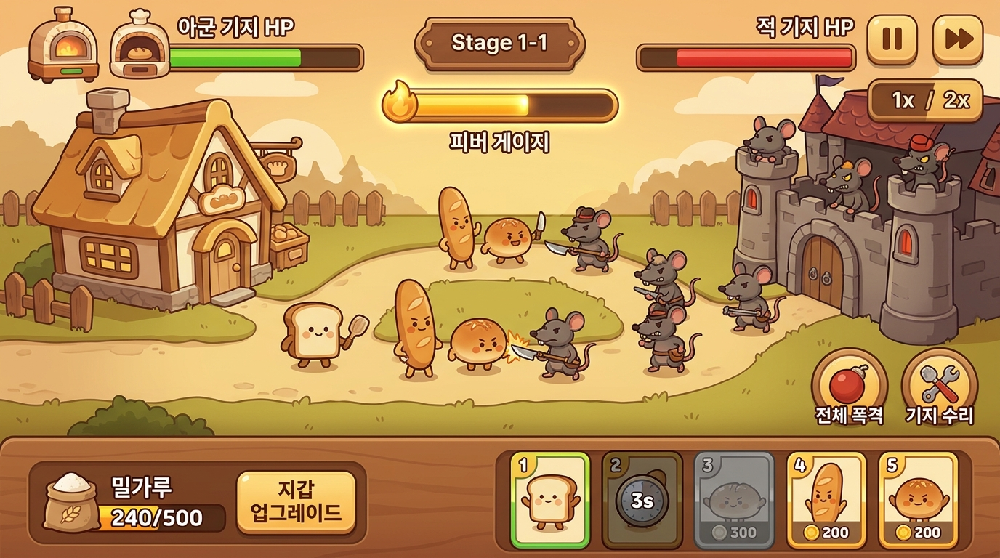

# [UI초안] 메인 인게임 전투 화면 및 결과창 구성안 (호걸)

## 1. [필수 첨부] 와이어프레임 / 목업 이미지

- 파일 경로: `docs/drafts/week1/images/ui_mockup.png`
- 기준 해상도: 1920 x 1080 (16:9 Landscape, Android Safe Area 여백 좌우 48px 확보)

---

## 2. [화면 배치 의도]

### 2-1. 상단 정보 영역 (Top Bar - 시각 정보 집중)
- 좌측 상단 (아군 기지 HP): 아군 오븐 아이콘과 녹색 게이지 바, 현재 HP/최대 HP 수치를 배치해 전선이 밀릴 때 위기감을 즉시 인지하도록 한다.
- 중앙 상단 (스테이지 & 피버 게이지): 현재 스테이지 번호 배지(`Stage 1-1`) 바로 아래에 불꽃 아이콘이 달린 황금색 `피버 게이지`를 두어, 시선을 중앙 전투 영역에서 크게 벗어나지 않고도 피버 발동 직전 타이밍을 파악하게 한다.
- 우측 상단 (적 기지 HP & 게임 제어): 적 성채 붉은색 HP 바 오른쪽에 `일시정지(II)` 버튼과 `1x / 2x 배속 전환(>>)` 버튼을 배치해 전투 중 오조작을 방지하면서도 쉽게 속도를 조절할 수 있다.

### 2-2. 중앙 전장 영역 (Center Battlefield)
- 전체 화면 높이의 약 62%를 할당해 아군(왼쪽 오븐)과 적군(오른쪽 치즈 성채)의 이동 및 충돌 연출을 방해 없이 보여준다.
- 우측 하단 전장 경계 위에는 액티브 소모품 버튼 2개(`전체 폭격`, `기지 수리`)를 독립 원형 버튼으로 배치해 엄지 터치로 긴급 상황에서 즉각 발동할 수 있게 한다.

### 2-3. 하단 조작 HUD 영역 (Bottom HUD Bar - 양손 엄지 조작 영역)
- 화면 하단 24% 높이를 따뜻한 나무 트레이 텍스처의 HUD 패널로 고정한다.
- 좌측 블록 (자원 & 지갑 강화): 밀가루 자루 아이콘과 수치(`240/500`) 옆에 큼직한 `지갑 업그레이드` 버튼을 배치한다(왼손 엄지 전담).
- 우측 블록 (유닛 소환 5슬롯): 최대 5마리 덱 슬롯을 가로 1열로 나열해 오른손 엄지로 빠르게 연타/선택 소환할 수 있다.

---

## 3. [버튼 피드백 설계] (성공 / 실패 / 상태별 시각화)

유닛 소환 슬롯과 버튼은 4가지 명확한 시각·촉각·청각 상태로 구분해 플레이어가 텍스트를 읽지 않아도 직관적으로 누를 수 있는지 판별하게 만든다.

1. 소환 가능 상태 (1번 슬롯 예시)
   - 카드 테두리가 밝은 녹색/금색으로 빛나며 배경이 밝은 크림색을 유지한다.
   - 터치 시: 카드가 0.92배 눌렸다가 1.05배 튀어 오르는 바운스 트윈(0.1초)과 함께 경쾌한 소환 효과음이 재생되고 즉시 밀가루가 차감된다.
2. 쿨타임 대기 상태 (2번 슬롯 예시)
   - 카드 위에 반투명 어두운 시계형 원형 오버레이(`Radial Fill`)와 남은 초(`3s`) 텍스트를 표시한다.
   - 쿨타임이 0초가 되는 순간 카드 전체에 짧은 하얀색 플래시(0.15초)가 번쩍이며 준비 완료를 알린다.
3. 코스트(밀가루) 부족 상태 (3번 슬롯 예시)
   - 카드 전체를 어두운 회색(Grayscale + 딤 처리)으로 비활성화하고 하단 코스트 숫자(`300`)를 붉은색/어두운 회색으로 표기한다.
   - 터치 실패 시: 슬롯이 좌우로 8px 짧게 2회 흔들리는(Shake) 연출과 함께 둔탁한 거절 효과음(`sfx_error` 계열)을 재생한다.
4. 지갑 업그레이드 버튼 상태
   - 필요 밀가루가 모이면 버튼 상단에 미세한 맥박(Pulse) 글로우를 주어 업그레이드 가능 시점을 알린다. 최대 레벨 도달 시 `MAX` 라벨로 전환하고 비활성화한다.

---

## 4. 결과창 및 로비 화면 구성안 (보충 설계)

### 4-1. 승리 / 패배 결과창 팝업
- 중앙 모달 팝업(반투명 어두운 배경 위에 양피지/오븐 메뉴판 디자인).
- 승리 시: 상단 별 1~3개 순차 점등 애니메이션 -> 획득 보상(골드 크럼, 별사탕, 최초 해금 유닛 카드) -> 하단 버튼 2종(`[목록으로]`, `[다음 스테이지]`).
- 패배 시: 쓰러진 식빵 캐릭터 일러스트 + 실패 원인 요약 힌트(예: "지갑 업그레이드를 조금 더 일찍 해보세요!") -> 하단 버튼 2종(`[유닛 강화하러 가기]`, `[다시 도전]`).

### 4-2. 로비 및 덱 편성/강화 화면
- 상단: 보유 골드 크럼, 황금 별사탕, 설정(사운드 볼륨 ON/OFF) 버튼.
- 중앙: 챕터 맵(Stage 1~10 빵 모양 스테이지 노드 연결, 현재 도전 가능 스테이지 강조).
- 하단: `[덱 편성/유닛 강화]`, `[아이템/유물 창고]`, `[출격하기]` 메인 CTA 버튼 배치.
