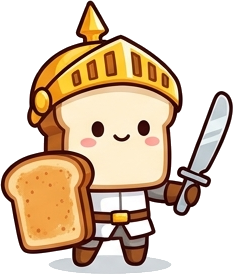
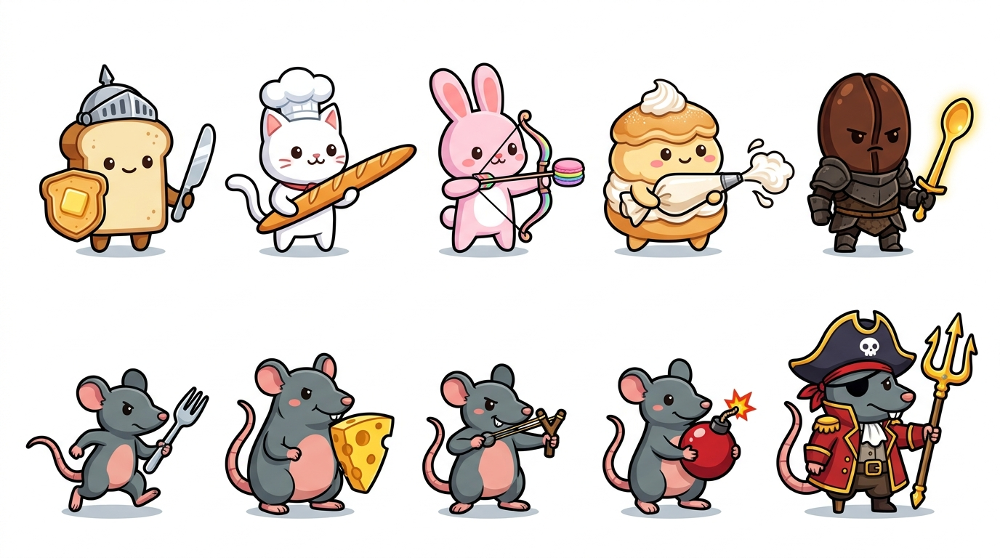

# [아트초안] 기본 아군 유닛 및 적군 스프라이트 시안 (호걸)

## 1. [필수 첨부] 투명 배경 스프라이트 샘플 (.webp) 및 전체 시트

### 1-1. 투명 배경 단일 유닛 샘플 (.webp)

- 파일 경로: `docs/drafts/week1/images/unit_bread_knight_transparent.webp`
- 포맷 검증: RGBA 알파 채널 투명 배경 무손실 WebP (233x274px)

### 1-2. 아군 & 적군 전체 컨셉 시트 (10종)

- 파일 경로: `docs/drafts/week1/images/character_concept.png`
- 상단 열 (아군 식빵 기사단 5종): 식빵 방패병 / 바게트 창병(고양이) / 마카롱 궁수(토끼) / 생크림 포격수(슈크림) / 에스프레소 기사(원두)
- 하단 열 (적군 도둑 쥐 해적단 5종): 포크 도둑 쥐 / 치즈 방패 쥐 / 새총 쥐 / 폭탄 쥐 / 해적왕 대왕쥐(보스)

---

## 2. [캐릭터 컨셉]

### 2-1. 아트 톤 & 매너
- 스타일: 2D 플랫 카툰 벡터 스타일. 굵고 일정한 진갈색 외곽선(`#3B2314`)과 2단계 셀 셰이딩(기본 면 + 그림자 면)을 사용해 모바일 화면에서도 캐릭터 외곽이 배경에 묻히지 않는다.
- 비율(SD 2등신): 머리와 무기/소품 비중을 크게 키워, 작은 스마트폰 화면에서 배속(2x)으로 여럿이 겹쳐 싸워도 병종(방패/창/활/짤주머니/대검)을 한눈에 구분할 수 있다.
- 색상 대비(피아 식별 규칙):
  - 아군(왼쪽 -> 오른쪽 전진): 따뜻한 크림, 골든 브라운, 핑크/화이트 파스텔 톤 중심.
  - 적군(오른쪽 -> 왼쪽 전진): 쿨 그레이(쥐 모피), 짙은 적색(스카프/폭탄/해적 코트), 노란 치즈 포인트 컬러.

### 2-2. 유닛별 제작 규격 (Unity 2D 기준)
- 기준 PPU (Pixels Per Unit): 100 (프로젝트 README 규격 준수)
- 일반 유닛 캔버스 크기: `256 x 256 px` 또는 `300 x 300 px` 정사각 기준 (발바닥 Pivot = `(0.5, 0.08)` 통일하여 바닥 높이가 어긋나지 않게 정렬)
- 보스 유닛 캔버스 크기: `512 x 512 px` (일반 유닛 대비 약 1.7~2배 크기)
- 방향 규칙: 모든 원본 스프라이트는 한 방향(오른쪽 전진 기준)으로 통일해 제작하고, 적군 배치 시 Unity `SpriteRenderer.flipX = true` 또는 `Transform.localScale.x = -1`로 좌우 반전해 리소스 양을 절감한다.

---

## 3. [모션 구상] (단기 개발 최적화 프레임 설계)

2~4주 단기 일정 내 완성도를 높이기 위해, 전통적인 풀프레임 셀 애니메이션 대신 `최소 핵심 키프레임 스프라이트 시트(3~4프레임) + Unity 코드/트윈 보조 연출(스쿼시&스트레치, 회전, 플래시)` 혼합 방식을 1안으로 제안한다.

### 3-1. 필수 5대 상태 모션 계획
1. 대기 (Idle) - 2프레임 또는 1프레임 스케일 숨쉬기
   - 호흡에 맞춰 Y축 스케일이 `1.0 -> 0.95 -> 1.0`으로 천천히 오르내리며 무기를 살짝 까딱거린다.
2. 이동 (Walk) - 2~3프레임
   - 아장아장 걷는 짧은 다리 교차 2프레임 + 걸음 타이밍에 맞춘 상체 살짝 기울임(Tilt ±5도).
   - 바게트 창병이나 폭탄 쥐처럼 돌진감이 필요한 유닛은 전방 기울임 각도를 12도로 강조한다.
3. 공격 (Attack) - 2~3프레임 (예비 동작 -> 타격/발사 -> 회수)
   - 근접 유닛(식빵 방패병, 바게트 창병, 에스프레소 기사): 팔을 뒤로 젖히는 준비(1프레임) -> 빠르게 휘두르거나 찌르는 타격(1프레임, 슬래시 이펙트 스프라이트 별도 소환) -> 복귀(1프레임).
   - 원거리 유닛(마카롱 궁수, 생크림 포격수, 새총 쥐): 활시위/새총 당기기(1프레임) -> 발사 반동(1프레임) + 투사체 프리팹 스폰.
4. 피격 / 넉백 (Hit & Knockback) - 1프레임 + 셰이더/컬러 연출
   - 별도 피격 그림을 최소 1종만 두거나(찡그린 표정), 공격받는 순간 0.1초간 순백색 플래시(`HitFlash`) + 뒤로 살짝 튕기는 포물선 트윈으로 경쾌한 타격 피드백을 구현한다.
5. 사망 (Death) - 1프레임 + 페이드/연기 파티클
   - 아군 빵 유닛: 빵 부스러기(Crumble) 파티클과 함께 반투명해지며 공중으로 살짝 떠올랐다 사라짐.
   - 적군 쥐 해적단: 눈이 `X_X` 또는 `@_@`가 된 기절 스프라이트로 뒤로 포물선을 그리며 날아간 뒤 `펑!` 하얀 연기 파티클과 함께 소멸(잔인하지 않은 코믹 연출).

---

## 4. 배경 및 타워(기지) 에셋 최소 리스트
- 배경 3종 (가로 1920x1080 원경/근경 2레이어 스크롤): 낮 빵집 마을 / 노을 밀가루 언덕 / 밤 치즈 성채.
- 기지 타워 2종 x 2상태(정상 / 반파(HP 50% 이하 금 가고 연기 나는 상태)): 아군 벽돌 오븐 제과점, 적군 치즈 성채.
