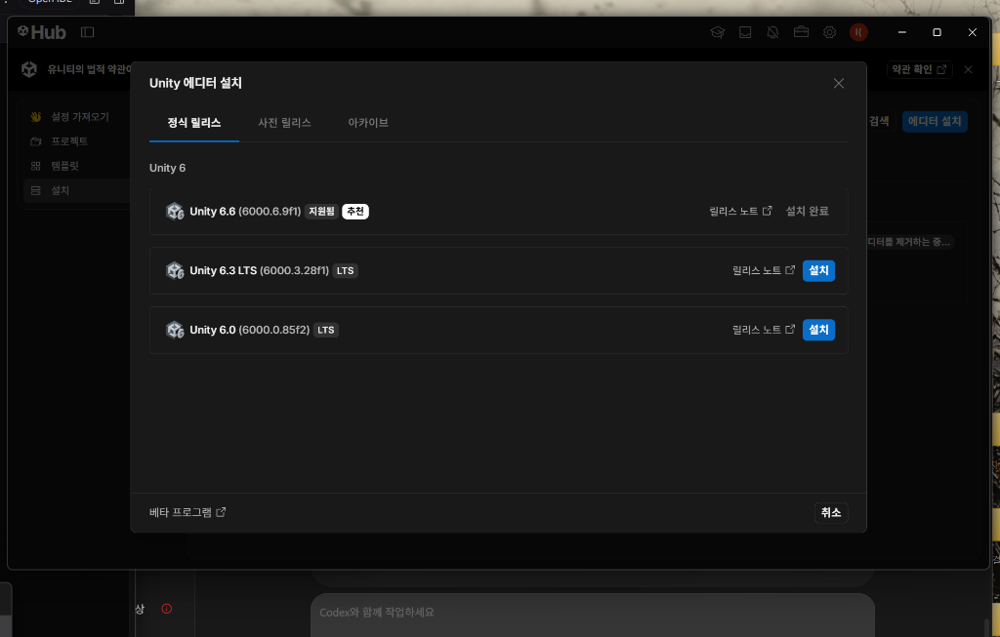
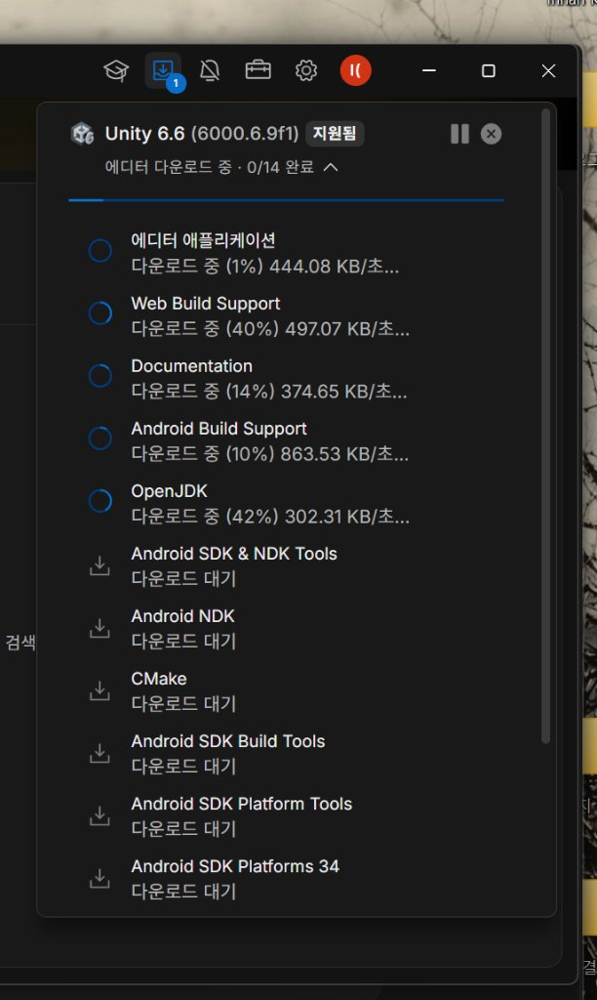
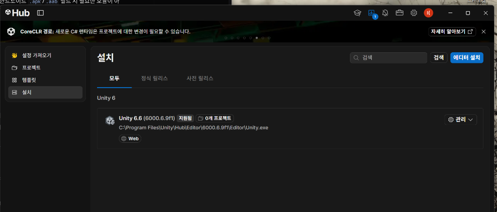
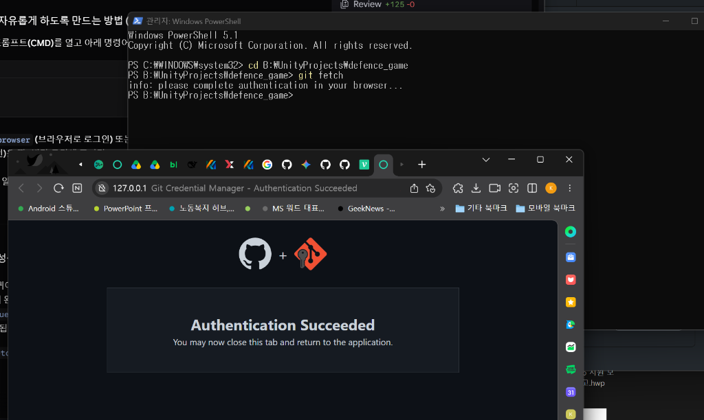
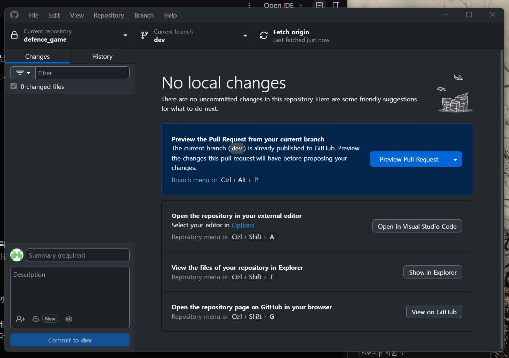
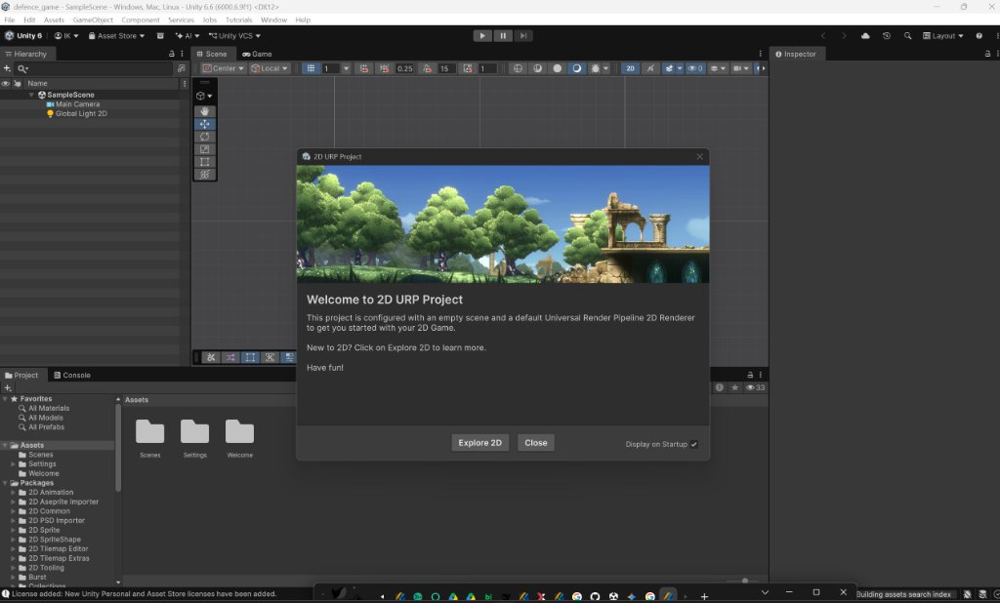

# 🛠 개발 환경 설치 및 설정 가이드 (초보자용 매뉴얼)

본 가이드는 **2D 디펜스 게임** 프로젝트에 참여하는 팀원분들이 처음부터 끝까지 혼자서도 쉽게 따라 하실 수 있도록 각 단계별 스크린샷과 함께 작성된 상세 설치 매뉴얼입니다.

---

## 📑 목차
1. [역할별 필요 프로그램 체크리스트](#1-역할별-필요-프로그램-체크리스트)
2. [1단계: Unity Hub 및 Unity Editor 설치](#2-1단계-unity-hub-및-unity-editor-설치)
3. [2단계: Git 및 GitHub Desktop 설치 & 설정](#3-2단계-git-및-github-desktop-설치--설정)
4. [3단계: VS Code 및 .NET SDK 8.0.428 설치](#4-3단계-vs-code-및-net-sdk-80428-설치)
5. [4단계: 프로젝트 다운로드(Clone) 및 Unity로 실행하기](#5-4단계-프로젝트-다운로드clone-및-unity로-실행하기)
6. [5단계: AI 도구(Claude, ChatGPT, Cline)와 함께 개발하기](#6-5단계-ai-도구claude-chatgpt-cline와-함께-개발하기)

---

## 1. 역할별 필요 프로그램 체크리스트

| 참여 역할 | Unity Editor (`6000.6.9f1`) | Git & GitHub Desktop | VS Code & .NET SDK | 안드로이드 실기기 |
|---|:---:|:---:|:---:|:---:|
| **직접 개발** | **필수** | **필수** | **필수** | 선택 |
| **부분 개발 (에셋/스크립트 초안)** | 선택 | **필수** | 권장 | - |
| **비개발 (기획/디자인)** | - | 권장 | - | - |
| **QA / 테스터** | - | - | - | **필수 (Android 8.0+)** |

---

## 2. 1단계: Unity Hub 및 Unity Editor 설치

### ① Unity Hub 설치 및 로그인
1. [Unity 공식 다운로드 페이지](https://unity.com/download)에서 Windows용 Unity Hub 설치 파일을 다운로드합니다.  
   *(만약 Windows 앱 패키지 오류가 발생하면 Microsoft Store에서 **`Unity Hub`**를 검색하여 설치하세요.)*
2. Unity Hub를 실행하고 **Unity 무료 계정(Personal)**으로 로그인합니다.

### ② Unity Editor `Unity 6.6 (6000.6.9f1)` 설치
팀원 전원이 **소수점까지 완전히 동일한 버전**을 설치해야 Git 충돌이 발생하지 않습니다.

1. Unity Hub 왼쪽 메뉴에서 **`설치(Installs)`** 클릭 → 오른쪽 위 **`에디터 설치`** 버튼 클릭!
2. 최신 릴리스 목록에서 **`Unity 6.6 (6000.6.9f1)`** 버전을 선택합니다.



### ③ 모듈 선택 (용량 절약 핵심 팁 💡)
모듈 선택 화면에서 필요한 항목만 정확하게 체크해야 설치 속도가 빠르고 디스크 용량을 낭비하지 않습니다.



- ❌ **`Microsoft Visual Studio Community`**: **체크 해제** (우리는 가벼운 VS Code를 사용합니다. 6GB 이상 절약!)
- ❌ **`Documentation`**: **체크 해제**
- ⚠️ **`Android Build Support`**:
  - 일반 PC에서 테스트/개발하실 분: **체크 해제** (PC 에디터의 ▶ Play 버튼으로 테스트 가능)
  - 스마트폰용 APK를 직접 빌드해보고 싶으신 분: **체크** (하위 OpenJDK, Android SDK & NDK 포함)
- 설치 위치는 C 드라이브 여유 공간이 10GB 미만일 경우 Unity Hub 설정(⚙️)에서 여유 있는 다른 드라이브(예: `B:\` 또는 `D:\`)로 지정하세요.

설치가 완료되면 아래와 같이 등록됩니다:


---

## 3. 2단계: Git 및 GitHub Desktop 설치 & 설정

명령어(터미널) 없이 버튼 클릭만으로 코드를 주고받기 위해 **GitHub Desktop**을 사용합니다.

1. **Git 설치**: [git-scm.com](https://git-scm.com/downloads)에서 최신 Git을 다운로드하여 기본 옵션 그대로 설치합니다.
2. **GitHub Desktop 설치**: [desktop.github.com](https://desktop.github.com/)에서 다운로드하여 설치합니다.
3. **GitHub Desktop 로그인**:
   - 상단 메뉴 `File` → `Options` → `Accounts`에서 본인 GitHub 계정으로 로그인합니다.
4. **터미널 인증 (최초 1회)**:
   - PowerShell을 열고 `git fetch` 실행 시 브라우저 인증 창이 뜨면 초록색 [Authorize]를 눌러 인증을 완료합니다.
   


---

## 4. 3단계: VS Code 및 .NET SDK 8.0.428 설치

코딩 및 AI 작성을 위해 가장 대중적인 **Visual Studio Code** 환경을 맞춥니다.

1. **VS Code 설치**: [code.visualstudio.com](https://code.visualstudio.com/)에서 설치합니다.
2. **.NET SDK `8.0.428` 설치 (필수)**:
   - [.NET 8.0 다운로드 페이지](https://dotnet.microsoft.com/ko-kr/download/dotnet/8.0) 접속
   - **.NET SDK 8.0.428** → Windows `x64` 설치 관리자(Installer)를 다운로드하여 설치합니다.
   - *(이게 설치되어 있어야 C# 코드의 자동완성과 오류 감지가 정상 작동합니다.)*
3. **VS Code 확장팩 설치**:
   - VS Code 실행 → 왼쪽 네모 아이콘(확장/Extensions) 클릭
   - 검색창에 **`Unity`** (Microsoft 제작) 검색 후 **설치**  
     *(이걸 설치하면 `C#`, `C# Dev Kit` 등 필수 확장팩 3개가 자동으로 함께 설치됩니다.)*

---

## 5. 4단계: 프로젝트 다운로드(Clone) 및 Unity로 실행하기

### ① GitHub Desktop으로 프로젝트 받기
1. GitHub Desktop 실행 → 상단 메뉴 `File` → **`Clone Repository...`** 클릭
2. `URL` 탭을 누르고 저장소 주소 입력:
   ```
   https://github.com/kangkung9225/defence_game.git
   ```
3. `Local path`를 본인이 작업하기 편한 경로로 지정 후 **`Clone`** 클릭!
4. 상단 가운데 **`Current branch`**를 클릭하고 **`dev`** 브랜치로 전환합니다!



### ② Unity Hub에 프로젝트 등록 및 열기
1. **Unity Hub** 실행 → 왼쪽 **`프로젝트`** 탭 클릭
2. 오른쪽 위 **`추가(Add)`** 버튼 옆 화살표 클릭 → **`디스크에서 프로젝트 추가`** 선택
3. 방금 Clone 받은 `defence_game` 폴더를 선택합니다.
4. 목록에 추가된 프로젝트를 클릭하여 실행합니다!

에디터가 정상적으로 로딩되면 아래와 같은 2D URP 화면이 열립니다:


### ③ Unity 에디터 스크립트 편집기 연결 (최초 1회 필수!)
Unity 에디터 맨 위 메뉴에서:
1. **`Edit` → `Preferences`** 클릭
2. 왼쪽 **`External Tools`** 탭 선택
3. 맨 위 **`External Script Editor`**를 **`Visual Studio Code`**로 변경하고 창을 닫습니다.

---

## 6. 5단계: AI 도구(Claude, ChatGPT, Cline)와 함께 개발하기

우리 프로젝트는 팀원 각자가 AI를 활용하여 빠르게 코드를 작성합니다. 프로젝트가 망가지지 않도록 아래 요령을 따라주세요.

1. **AI 프롬프트 표준 멘트**:
   > *"이 프로젝트는 Unity 6 2D URP 환경이며, 루트 경로의 `DEVELOPMENT_GUIDE.md` 파일의 아키텍처 규칙과 C# 코딩 표준을 엄격하게 지켜서 작성해 줘."*
2. **에셋/스크립트 파일 조작 주의**:
   - 파일 이동, 삭제, 이름 변경은 터미널/AI 명령어가 아니라 **반드시 Unity 에디터 Project 창에서 마우스로** 해주세요. (Unity의 `.meta` 파일 보호 목적)
3. **작업 완료 후 공유 루틴**:
   - 작업 시작 전 GitHub Desktop에서 항상 **`Fetch origin` → `Pull`**로 최신 코드 받기
   - 작업 완료 후 GitHub Desktop에서 본인 브랜치로 `Commit & Push` 후 **`dev` 브랜치로 Pull Request (PR)** 발송!

---
궁금한 점이나 설치 중 막히는 부분이 있다면 언제든 단톡방에 스크린샷과 함께 문의해 주세요! 🙌
