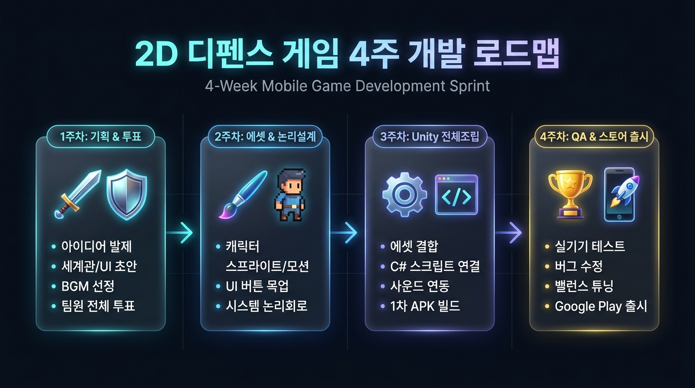

# 4주 타임테이블 고도화 개발 로드맵

단기 4주 동안 팀원 전원이 유기적으로 협업하여 기획부터 구글 플레이스토어 출시까지 완주하기 위한 주차별 세부 파이프라인입니다.

---

## 📅 주차별 핵심 마일스톤 한눈에 보기

| 주차 | 핵심 목표 | 파트별 집중 역할 |
|---|---|---|
| 1주차 | 컨셉/기획/사운드 100% 확정 | [전원 자유 참여] 기획·UI·아트·사운드 초안 제출 & 팀원 전체 투표 |
| 2주차 | 정식 에셋 완성 & 논리 설계 | [아트/사운드] 스프라이트·모션·UI / [개발] 시스템 논리회로 및 FSM |
| 3주차 | 전체 시스템 조립 & Unity | [직접 개발] 모든 소스 Unity 조립 / [타파트] 실시간 피드백 지원 |
| 4주차 | QA 테스트 & 스토어 출시 | [전원] 실기기 평가지 작성 & 핫픽스 & 최종 Google Play 배포 |

---

## 1. [1주차] 컨셉, 기초 기획 & 음악 초안 100% 확정 (전원 자유 참여)
- 목표: 어떤 게임을 만들 것인가에 대한 모든 아이디어를 수렴하고 팀원 전체 투표로 100% 확정하는 주간입니다.
- 주요 활동 (팀원 전원 자유 참여):
  - 세계관 & 시나리오: 배경 스토리, 아군 기지와 적 본거지의 대립 이유 확정
  - 캐릭터 & 몬스터 기믹: 초기 유닛 및 적의 외형 컨셉, 상성, 스킬 기믹 초안 작성
  - 음악/사운드 톤앤매너 확정: 메인 테마 BGM 레퍼런스 및 후보곡 선정 (경쾌/코믹/판타지 등)
  - UI/UX 레이아웃 초안: 전투 화면 및 로비 화면 스케치(와이어프레임) 등록
- 1주차 마감:
  - 팀원 전체 투표 진행: 각 파트별 제출된 초안 중 최고 득표작을 프로젝트 공식 스펙으로 최종 채택
  - 개발팀은 채택된 사양에 맞춰 2주차 논리 설계 준비

---

## 2. [2주차] 투 트랙(Two-Track) 분업: 정식 에셋 제작 & 시스템 논리 회로 설계
1주차에 채택된 스펙을 바탕으로, 아트/사운드팀은 시각·청각 소스를 완성하고 개발팀은 시스템 논리 회로와 코어 프로토타입 뼈대를 구축합니다.

### 🎨 트랙 A: 아트 / UI / 사운드 제작팀
- 캐릭터 스프라이트 & 모션 에셋 완성:
  - 채택된 캐릭터들의 대기, 걷기, 공격, 피격, 사망 모션 프레임 이미지(.webp, .png) 제작
- 배경 및 전장 오브젝트:
  - 전장 배경(원경/근경 스크롤 레이어), 아군 기지 타워, 적군 기지 성 그래픽 완성
- UI/UX 정식 디자인 (Figma / 포토샵):
  - 메인 화면 내 각 버튼의 시각 상태(기본/호버/비활성화) 에셋 분리
  - 소환 버튼 슬롯, 쿨타임 오버레이, 코스트 게이지 바, 일시정지, 승리/패배 팝업 에셋 추출
- 사운드 에셋 구축:
  - 메인/전투 BGM 최종 음원(.mp3) 및 타격음, 소환음, 승리 효과음(.wav) 폴더 배치

### 💻 트랙 B: 클라이언트 개발팀 (시스템 논리 회로 및 아키텍처 설계)
- 시스템 상태 전이 및 논리 회로(Logical Circuit / State Flow) 작성:
  - 메인 화면 버튼 흐름도: 각 버튼을 누르면 어떤 씬/팝업으로 가는지(예: 출격 버튼 → 덱 편성 확인 → 전투 씬)
  - 인터랙션 성공/실패 조건부 동작 처리:
    - 소환 버튼 클릭 시: `코스트 >= 유닛 소환 비용` AND `쿨타임 == 0` 인가?
      - 성공: 코스트 즉시 차감, 쿨타임 타이머 작동, 아군 기지 스폰 위치에 유닛 생성 후 전진 시작
      - 실패: 버튼 흔들림 애니메이션 또는 코스트 부족 팝업 피드백 출력
  - 유닛 상태 머신(FSM) 논리 설계:
    - [이동] 중 전방 사거리 내 타깃 감지 시 → [정지 후 공격] 상태 전환
    - 공격 딜레이 동안 대기 → 타깃 체력 감소 → 타깃 체력 0 도달 시 [사망 처리] 후 다시 [이동] 재개
  - 승패 판정 회로: 아군 기지 체력 0 도달 시 패배 시퀀스 작동, 적군 기지 체력 0 도달 시 승리 시퀀스 작동
- 데이터 구조(Data Architecture) 설계:
  - 유닛 스탯(체력, 공격력, 이동속도, 사거리, 쿨타임, 코스트)을 관리할 ScriptableObject 구조화
  - 임시 도형 더미 리소스로 코어 전투 루프 검증

---

## 3. [3주차] 전체 시스템 조립 & Unity 구현 (직접 개발 올인 & 실시간 피드백)
2주차에 준비된 모든 그래픽, 사운드, UI, 기획 데이터를 Unity 프로젝트 안에서 실제로 완벽하게 돌아가도록 조립하는 주간입니다.

- 직접 개발팀 중심 작업:
  - 에셋 결합: 더미 사각형을 2주차에 완성된 정식 캐릭터 스프라이트 및 애니메이터와 교체
  - UI 연동: 화면 목업에 맞춰 Canvas 배치, 소환 버튼 쿨타임 및 코스트 바 실시간 수치 연동
  - 사운드 매니저 구축: BGM 루프 재생 및 소환/타격/결과 시점의 SFX 효과음 연결
  - 스테이지 확장 & 저장: 1~5 스테이지 웨이브 데이터 연동, 클리어 상태 및 골드 재화 로컬 저장 (PlayerPrefs)
- 타 파트(기획/아트/사운드)의 역할 (실시간 피드백 지원):
  - 개발 중인 화면을 보며 애니메이션 프레임 속도, 사운드 볼륨 밸런스, UI 배치 간격 실시간 검토
  - 필요한 추가 땜빵 에셋(아이콘, 폰트, 미세 이펙트) 즉시 지원
- 3주차 마감:
  - 1차 내부 테스트용 APK 빌드 생성 및 팀 공유

---

## 4. [4주차] QA 테스트, 밸런스 튜닝 & 구글 플레이 출시
- 목표: 실제 유저 관점에서의 버그 퇴치, 난이도 조정 및 구글 플레이스토어 정식 배포
- 세부 활동:
  - 테스터(QA) 및 팀원 전원 플레이:
    - 스마트폰에 APK를 설치하고 직접 플레이
    - [테스터 평가지] 항목 작성:
      - 1) 조작감 및 터치 반응성
      - 2) 스테이지별 난이도 체감 (너무 쉬움 / 적절 / 불합리함)
      - 3) 발견된 버그 현상 및 이상 동작 (GitHub Issues에 즉시 제보)
  - 개발팀: 제보된 버그 긴급 픽스(Hotfix) 및 코스트/유닛 공격력 수치 미세 튜닝
  - 배포 담당:
    - 스토어 등록용 대표 스크린샷 캡처 및 앱 설명문 작성
    - Unity Build Settings에서 Build App Bundle (Google Play) 옵션으로 .aab 최종 빌드 추출
    - 구글 플레이 개발자 콘솔에 업로드 및 출시 심사 제출

